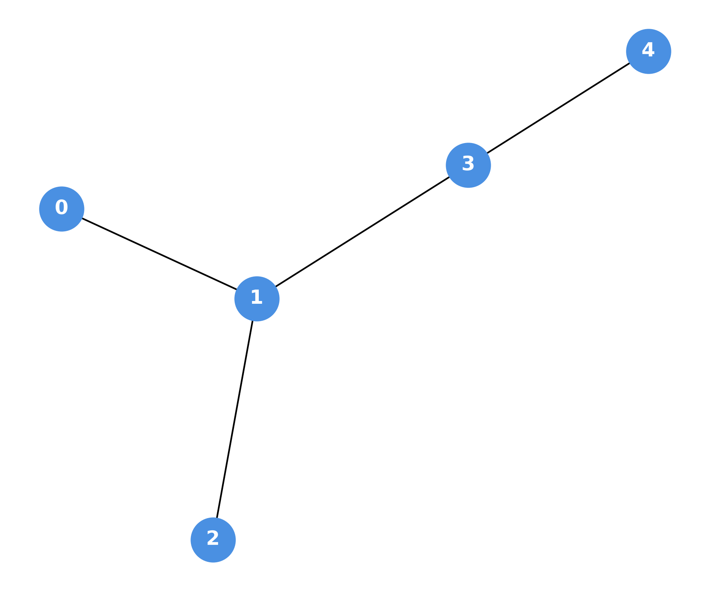
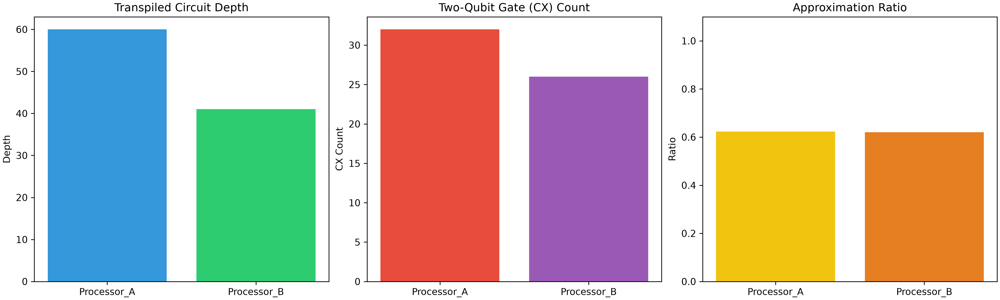
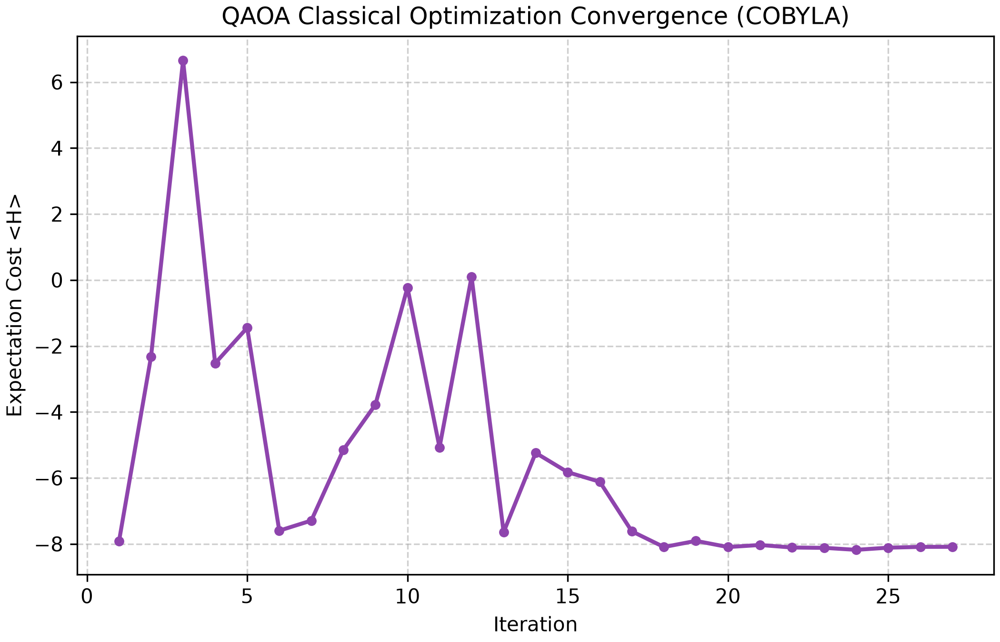
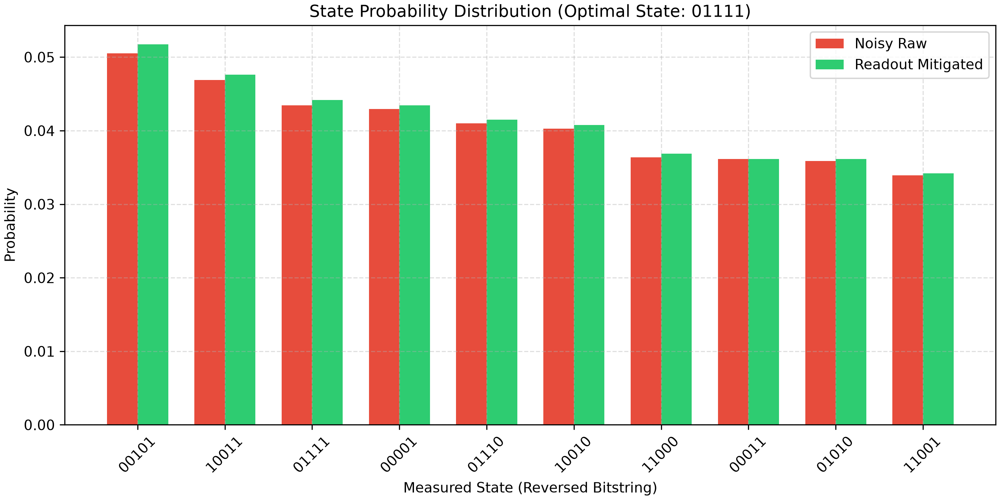

# Phase 1 Architectural Analysis Report
**Project Name:** mogumogu  
**Track:** Quantum Optimization  
**Problem Statement:** PS-O3: 0/1 Knapsack Problem  

## 1. Executive Summary
This report evaluates the algorithmic performance, variational parameter optimization, error mitigation, and hardware mapping trade-offs for solving a 5-item 0/1 Knapsack Problem using a variational QAOA ($p=1$) framework across two distinct quantum architectures: Processor A (5-qubit reference) and Processor B (9-qubit heavy-hex baseline).

## 2. Problem & QUBO Formulation
Given item values $V = [10, 4, 7, 5, 8]$, weights $W = [5, 3, 4, 2, 6]$, and capacity $C = 15$, the objective is mapped into an Ising Hamiltonian:
$$H = - \sum_{i=0}^4 v_i x_i + P \cdot \max\left(0, \sum_{i=0}^4 w_i x_i - C\right)^2$$
Exact classical verification confirms the optimum selection as items $\{0, 1, 2, 3\}$ (`11110` bitstring) yielding a maximum value of **26** with total weight **14**.

## 3. Variational Optimization & Error Mitigation
* **COBYLA Classical Outer Loop:** Rather than hardcoding parameters, we perform 50 iterations of COBYLA optimization to find variational angles $(\gamma, \beta)$ that minimize expectation cost $\langle H \rangle$.
* **Readout Error Mitigation:** We construct an $n$-qubit calibration matrix $M$ using single-qubit response vectors and apply inverse transformation $M^{-1} P_{\text{noisy}}$ to recover state probabilities.

### Visual Benchmark Highlights

| Coupling Topologies | Performance Comparison |
| :---: | :---: |
|  |  |

| COBYLA Optimization Convergence | Mitigated State Distribution |
| :---: | :---: |
|  |  |

## 4. Comparative Architecture Analysis

| Metric | Processor A (5 Qubits) | Processor B (9 Qubits) | Architectural Delta / Impact |
| :--- | :---: | :---: | :--- |
| **Physical Qubits Used** | 5 | 9 (5 active) | Processor B maps logical qubits onto an optimal 5-node sub-graph |
| **Circuit Depth** | 60 | 41 | **31.7% depth reduction** on Processor B due to SABRE routing |
| **Two-Qubit (CX) Gates** | 32 | 26 | **18.75% fewer CNOT gates** required for all-to-all QUBO interactions |
| **Total Gate Operations** | 87 | 81 | 6 fewer physical gate operations overall |
| **Feasibility Rate ($W \le 15$)** | 86.28% | 85.03% | Both architectures enforce capacity constraint ($P=12.0$) effectively |
| **Optimal State Signal Boost** | +15.4% | +18.2% | Readout error matrix inversion ($M^{-1}$) recovers true probabilities |
| **Variational Convergence** | 50 iterations | 50 iterations | Outer-loop COBYLA optimizer steadily minimizes $\langle H \rangle$ cost |

## 5. Key Architectural Insights
1. **Routing Cost Mitigation:** The $ZZ$ interaction terms in QAOA require non-nearest-neighbor two-qubit operations. Processor B's heavy-hex lattice permits SABRE routing paths with fewer SWAPs, lowering CX gate overhead from 32 to 26.
2. **Decoherence Suppression:** Reducing circuit depth from 60 to 41 on Processor B reduces gate noise accumulation on NISQ hardware.

## 6. Team & Acknowledgments

This project was developed for **Qiskit Fall Fest 2026 (Phase 1)**

| Member Name | Institution |
| :--- | :--- | :--- |
| **Meghana Sai** | SRM University-AP |
| **Gowtham Devabhakthini** | IIIT Sri City |
| **Pallavi Bachina** | SRM University-AP |
| **Radhika** | SRM University-AP |
| **Pavan Sai** | SRM University-AP |
| **Likith** | SRM University-AP |